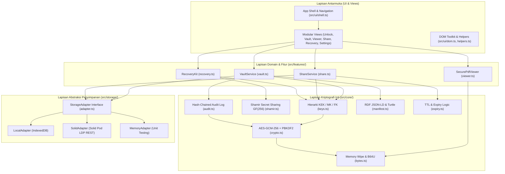
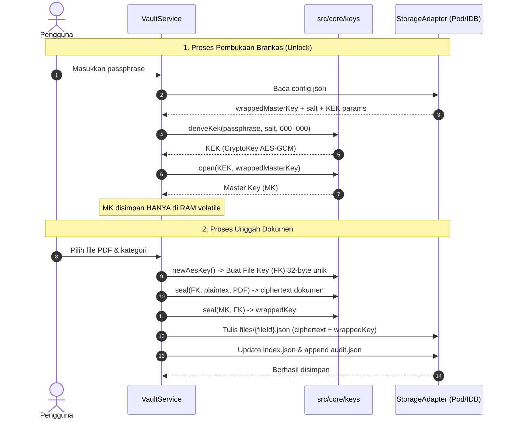

# PodVault — Arsitektur Sistem (MVP)

Dokumen ini menguraikan arsitektur sistem, pembagian lapisan modul, alur data kriptografi, dan tata letak penyimpanan PodVault.

---

## 1. Diagram Arsitektur Tingkat Tinggi



---

## 2. Pembagian Lapisan (Layering)

PodVault dibangun tanpa framework pihak ketiga (Vanilla TypeScript + Web APIs murni) dengan pemisahan tanggung jawab yang ketat:

### 2.1 Core Layer (`src/core/`)
Lapisan ini sepenuhnya deterministik, bebas dari dependensi DOM/UI/Storage, dan hanya beroperasi pada struktur data murni dan `Uint8Array`.
- `bytes.ts`: Utilitas CSPRNG (`randomBytes`), serialisasi Base64URL (`toB64u`, `fromB64u`), UTF-8 encoding, dan fungsi kritis `wipe()` untuk membersihkan *buffer* memori sensitif.
- `crypto.ts`: Wrapper Web Crypto API untuk AES-GCM 256-bit (12-byte random IV, 128-bit authentication tag) dan PBKDF2-SHA256 (600.000 iterasi).
- `keys.ts`: Manajemen hierarki kunci (KEK, Master Key, File Key). Memastikan verifikasi SHA-256 saat pembongkaran cipher (`openFile`).
- `shamir.ts`: Implementasi skema pembagian rahasia Shamir berbasis Galois Field $GF(2^8)$ dengan polinomial reduksi $0x11B$ ($x^8 + x^4 + x^3 + x + 1$).
- `audit.ts`: Log aktivitas berantai hash (*hash-chaining*), di mana setiap entri mengikat hash rekaman sebelumnya (`sha256(prevHash + '|' + canonicalJson)`).
- `manifest.ts`: Pembentukan manifest semantik dokumen publik berbasis RDF JSON-LD dan serialisasi Turtle (`text/turtle`).
- `expiry.ts`: Evaluasi kedaluwarsa waktu (*Time-To-Live*) dan format waktu ramah pengguna.

### 2.2 Storage Layer (`src/storage/`)
Menyediakan antarmuka terpadu `StorageAdapter` dengan operasi: `init()`, `readText()`, `writeText()`, `remove()`, dan `list()`.
- `LocalAdapter`: Menyimpan dokumen di IndexedDB peramban pengguna (`podvault` database, `kv` store). Digunakan sebagai mode default (offline-first).
- `SolidAdapter`: Berkomunikasi langsung dengan Solid Pod menggunakan protokol W3C LDP (Linked Data Platform) melalui REST API (`PUT`, `GET`, `DELETE`) dan membaca daftar kontainer menggunakan representasi Turtle.
- `MemoryAdapter`: Mock penyimpanan berbasis `Map` dalam RAM untuk pengujian unit otomatis yang cepat dan andal.
- `config.ts`: Menyimpan konfigurasi koneksi dan preferensi antarmuka pengguna di `localStorage`.

### 2.3 Feature Layer (`src/features/`)
Mengorkestrasikan logika bisnis aplikasi:
- `VaultService`: Mengelola daur hidup brankas (buat, buka, kunci, unggah, hapus, ganti passphrase), menjaga integritas indeks file, dan mencatat jejak audit.
- `SecurePdfViewer`: Memuat dokumen PDF terenkripsi, mendekripsinya di memori, merender halaman per halaman ke elemen HTML5 `<canvas>`, serta membakar watermark forensik dinamis langsung ke data piksel kanvas.
- `ShareService`: Membuat tautan berbagi terisolasi, mengenkripsi payload dengan kunci share terpisah, dan memvalidasi akses penerima.
- `RecoveryKit`: Menghasilkan lembar kertas A4 pemulihan bencana (*Emergency Recovery Sheet*) ber-QR code dan memulihkan brankas dari 3 pecahan share.

### 2.4 UI Layer (`src/ui/`)
- `dom.ts` & `helpers.ts`: Pembangun elemen DOM aman tanpa `innerHTML` dari data eksternal, modal dialog, toast notifikasi, dan pemformat data.
- `shell.ts`: Tata letak utama dengan sidebar navigasi, indikator status keamanan, dan tombol kunci instan.
- `views/`: Halaman-halaman modular (`unlock`, `vault`, `file`, `shares`, `recovery`, `settings`, `public-share`).

---

## 3. Model Hierarki Kunci & Alur Enkripsi



---

## 4. Tata Letak Penyimpanan (Storage Layout)

Baik di IndexedDB lokal maupun di Solid Pod, struktur hierarki berkas disimpan secara konsisten:

```text
/
├── config.json          # Konfigurasi brankas, WebID, wrappedMasterKey, salt, pengaturan
├── index.json           # Indeks daftar dokumen (id, nama, kategori, ukuran, hash)
├── audit.json           # Rantai audit log (event, prevHash, hash, timestamp, actor)
├── manifest.jsonld      # Metadata semantik W3C (JSON-LD)
├── files/               # Direktori catatan dokumen terenkripsi
│   ├── {uuid-1}.json   # Ciphertext dokumen 1 + wrappedKey (dienkripsi dengan MK)
│   └── {uuid-2}.json   # Ciphertext dokumen 2 + wrappedKey
└── shares/              # Direktori tautan berbagi berbatas waktu
    └── {shareId}.json   # Ciphertext dokumen + wrappedKey untuk penerima + metadata kadaluwarsa
```

Setiap file di dalam folder `files/` memiliki skema data:
```json
{
  "id": "550e8400-e29b-41d4-a716-446655440000",
  "name": "sertifikat-tanah.pdf",
  "category": "aset",
  "size": 5543,
  "createdAt": "2026-10-29T04:42:47.000Z",
  "sha256": "e3b0c44298fc1c149afbf4c8996fb92427ae41e4649b934ca495991b7852b855",
  "wrappedKey": {
    "iv": "...",
    "data": "..."
  },
  "cipher": {
    "iv": "...",
    "data": "..."
  }
}
```

---

## 5. Pertimbangan Kinerja & Skalabilitas

1. **Lazy Loading PDF.js:** Library PDF.js (~350KB) hanya dimuat ke peramban saat pengguna pertama kali membuka tampilan dokumen.
2. **Paging Render Kanvas:** Dokumen multi-halaman tidak dirender sekaligus ke memori; render dilakukan per halaman aktif guna menghemat alokasi memori kanvas perangkat seluler.
3. **Penyimpanan Berkas Terpisah:** Berkas dokumen disimpan di path individu (`files/{id}.json`), sehingga memuat daftar brankas hanya perlu membaca `index.json` (~beberapa KB) tanpa mentransfer ciphertext dokumen berukuran besar.
